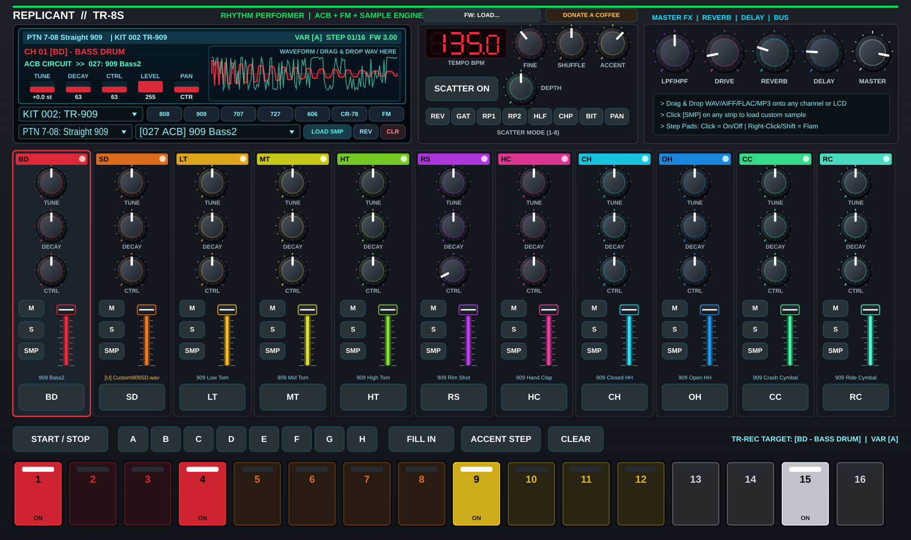

# REPLICANT TR-8S // 1:1 TR-8S Rhythm Performer Clone (v3.00 Firmware)

<p align="center">
  <strong>1:1 Hardware & Firmware-Driven Clone of the TR-8S Rhythm Performer (v3.00)</strong><br>
  <em>Audio Plugin: VST3 • AU • Standalone for Windows, Linux, and macOS</em>
</p>

<p align="center">
  
</p>

<p align="center">
  📘 <strong><a href="docs/ReplicantTR8S_User_Manual.pdf">Download Official User Manual & Usability Guide (PDF — English & Español)</a></strong>
</p>

<p align="center">
  <a href="https://paypal.me/DanimanX?locale.x=en_US&country.x=CL">
    
  </a>
</p>

---

## 🎛️ Overview

**ReplicantTR8S** is a 1:1 virtual recreation of the **TR-8S Rhythm Performer**, built directly from the unpacked **v3.00 System Firmware (`tr8s_sys_v300/TR8S_UP.bin`)**.

By decompressing the internal `rpg42_init_param.bin` LZSS parameter database inside `TR8S_UP.bin`, **ReplicantTR8S** embeds the exact factory tables from the hardware:
- **All 128 Factory Kits** (`001: TR-808`, `002: TR-909`, `003: TR-707`, `004: TR-727`, `005: TR-606`, `006: TR-626`, `085: CR-78`, `087: FM-Groover`, ..., `127: CR-78S`) with their exact per-channel Tone IDs, Tune, Decay, Level, Ctrl, Pan, Reverb Send, and Delay Send.
- **All 128 Factory Patterns** (`1-01 Gam Groover` through `8-16 626 Variation 2`, including `808 Variation 1–7`, `909 Variation 1–4`, `Straight 909`, `CR-78 LATIN/DISCO/ROCK/Triplets`, `Berlin Flyover`, `Detroit Love`, `Warehouse`, etc.) across all **8 Variations (`A–H`)** and **11 Instrument Channels + Accent**.
- **All 522 Factory Tones** across **ACB (Analog Circuit Behavior)**, **2-Operator FM Drum Synthesis**, and **Preset PCM/Synth/Chord** models.
- **Per-Channel Custom Sample Loader**: Load your own `.wav`, `.aiff`, `.flac`, `.mp3`, or `.ogg` samples into any of the 11 channels (`BD`, `SD`, `LT`, `MT`, `HT`, `RS`, `HC`, `CH`, `OH`, `CC`, `RC`) via the **`[SMP]`** button on each channel strip, the **`[LOAD SMP]`** button on the LCD screen, or by **Dragging & Dropping** audio files directly onto any channel strip or the LCD display.

---

## 💾 Firmware Binary Requirement (`tr8s_sys_v300.zip` / `TR8S_UP.bin`)

### Clean-Room Legal Compliance (Bring Your Own Firmware)
For copyright and intellectual property compliance, **ReplicantTR8S does not distribute or embed any proprietary firmware binaries or extracted ROM tables in this repository or in pre-built releases.**

Instead, **ReplicantTR8S** includes a native C++ **Runtime Firmware Loader** (`Source/Firmware/TR8SFirmwareLoader.cpp`):
1. **First Launch Prompt**: When you launch the `Standalone` app or load the `VST3` / `AU` plugin for the first time, a startup screen prompts you to provide your own copy of **`tr8s_sys_v300.zip`** or **`TR8S_UP.bin`** (System Program v3.00).
2. **Click or Drag & Drop**: Click **`[SELECT FIRMWARE FILE (tr8s_sys_v300.zip / TR8S_UP.bin)]`** or **Drag & Drop** the `.zip` / `.bin` file directly onto the plugin window.
3. **In-Memory Decompression**: The plugin parses the POSIX TAR container (`TR8S_UP.bin`) in memory, locates `./_tmp/rpg42_init_param.bin`, decompresses the Haruhiko Okumura LZSS stream (`3,407,824` bytes), and populates all **128 Factory Kits**, **128 Factory Patterns**, and **522 Factory Tones** dynamically at runtime.
4. **Automatic Path Persistence**: Once loaded, the path to your firmware file is saved automatically in your user application data directory (`~/.config/ReplicantTr8s/firmware_location.txt` on Linux, `~/Library/Application Support/ReplicantTr8s/` on macOS, or `%APPDATA%\ReplicantTr8s\` on Windows) so subsequent sessions start immediately. You can also reload or switch the firmware file at any time via the **`[FW v3.00: READY (CHANGE)]`** button in the top header bar.

---

## ✨ Key Features

### 🖥️ Interactive Backlit LCD Screen & 7-Segment Tempo Display
- **Top Status Ribbon**: Displays current Pattern (`PTN 7-08 Straight 909`), current Kit (`KIT 001 TR-808` / `KIT 002 TR-909`), active Variation (`VAR A–H`), live Step counter (`01/16`), and Firmware version (`FW 3.00`).
- **Channel & Tone Inspector**: Shows the currently selected channel (`CH 01 [BD] - BASS DRUM`), engine type (`ACB CIRCUIT`, `FM 2-OP`, `PCM SYNTH`, or `USER SAMPLE`), tone/sample name, and real-time bar graphs for `TUNE`, `DECAY`, `CTRL`, `LEVEL`, and `PAN`.
- **Real-Time Waveform & Oscilloscope Visualizer**: Renders the synthesized or user-loaded sample waveform with live decay envelope shaping alongside a real-time stereo master oscilloscope.
- **Instant Parameter Popup Overlay**: Turning any knob or moving any fader pops up an authentic high-contrast readout on the LCD screen.
- **1-Click Classic Kit Bank Buttons**: Instant switching between **`808`**, **`909`**, **`707`**, **`727`**, **`606`**, **`CR-78`**, and **`FM`** kits, plus full dropdown selectors for all **128 Kits**, **128 Patterns**, and **522 Tones**.

### ⚡ Multi-Engine DSP Core (ACB + FM + User Sampler)
1. **TR-808 ACB Models**:
   - **BD**: Bridged-T network resonant oscillator with pitch sweep, click impulse, and sub-bass extension (`808 Bass1/2`, `Long`, `808 Chromatic Bs`).
   - **SD**: Dual bridged-T shells (`180 Hz` & `330 Hz`) + high-pass filtered snappy wire noise (`CTRL`).
   - **LT / MT / HT & Congas**: Bridged-T resonant oscillators with pitch bend and pink noise transient.
   - **RS / Claves**: Dual resonant modal bandpass (`470 Hz` + `1720 Hz`) and `2480 Hz` pure clave sine.
   - **HC / Maracas**: 3×11ms sawtooth-modulated noise bursts + reverberant tail through a `1.15 kHz` resonant bandpass filter.
   - **CH / OH / CC / RC / Cowbell**: 6-oscillator non-harmonic metallic square-wave bank (`205.3–800 Hz`) with authentic Closed/Open Hi-Hat choke group (`CH` chokes `OH`).
2. **TR-909 ACB Models**:
   - **BD**: Triangle-core VCO with diode sine waveshaper, 2-stage pitch envelope, and aggressive pulse/noise attack click (`CTRL`).
   - **SD**: Dual triangle oscillators + dual-envelope snappy noise.
   - **LT / MT / HT / RS / HC**: Authentic 909 analog synthesis circuits.
   - **CH / OH / CC / RC**: 6-bit / 32 kHz vintage EPROM metallic hats and crash/ride cymbals with analog VCA envelopes.
3. **TR-707, TR-727, TR-606, TR-626, CR-78 & 2-Op FM Models**:
   - Complete 12-bit companded PCM drums (`707`/`626`), Latin percussion (`727` Bongos, Congas, Timbales, Agogo, Whistle, Quijada, Star Chime), `606` transistor drums, `CR-78` LC-tank drums (including Guiro, Tambourine, and Metal Beat), and 2-Operator `FM` synthesis (`CTRL` = FM Morph).
4. **Custom User Sample Engine**:
   - Load `.wav`, `.aiff`, `.flac`, `.mp3`, or `.ogg` into any of the 11 channels.
   - Supports pitch shifting (`TUNE` `-24..+24 st`), amplitude envelope shaping (`DECAY`), drive/filter shaping (`CTRL`), reverse playback (`REV`), and DAW state persistence.
5. **Master Effects & SCATTER**:
   - Per-channel Reverb & Tempo-Synced Dotted-8th Delay sends, Master DJ Isolator Filter (`LPF / HPF`), Analog Bus Drive, and 8-Mode **SCATTER** performance processor (`REV`, `GAT`, `RP1`, `RP2`, `HLF`, `CHP`, `BIT`, `PAN`).

---

## 📦 Downloads & Installation

Download pre-built packages for your operating system from [Releases](https://github.com/DanimanX/ReplicantTr8s/releases).

### Plugin Directories
* **macOS:**
  * VST3: `~/Library/Audio/Plug-Ins/VST3/ReplicantTR8S.vst3`
  * AU: `~/Library/Audio/Plug-Ins/Components/ReplicantTR8S.component`
* **Linux:**
  * VST3: `~/.vst3/ReplicantTR8S.vst3` (or `/usr/lib/vst3/`)
* **Windows:**
  * VST3: `C:\Program Files\Common Files\VST3\ReplicantTR8S.vst3`

---

## 🛠️ Building from Source (Linux, Windows, macOS)

Requires **CMake 3.22+** and a **C++20** compiler (`GCC`, `Clang`, or `MSVC`). **JUCE 8.0.4** is fetched automatically via CMake `FetchContent`.

```bash
# 1. Configure CMake
cmake -B build -DCMAKE_BUILD_TYPE=Release

# 2. Build VST3, Standalone (and AU on macOS)
cmake --build build --config Release --parallel
```

---

## 🤖 CI/CD (GitHub Actions)

Automated multi-platform builds and releases run via `.github/workflows/build.yml` on every push and tag:
* **macOS Universal Binary** (Apple Silicon M1/M2/M3/M4 + Intel x86_64)
* **Linux x86_64** (Ubuntu, Debian, Arch, Fedora)
* **Windows x64** (Windows 10 / 11)

---

## ☕ Support the Project (Buy Me a Coffee)

If you enjoy using **ReplicantTR8S** in your studio or live sets and want to support its development, feel free to buy me a coffee via PayPal:

<p align="center">
  <a href="https://paypal.me/DanimanX?locale.x=en_US&country.x=CL">
    
  </a>
</p>

* **PayPal Donation Link:** [https://paypal.me/DanimanX?locale.x=en_US&country.x=CL](https://paypal.me/DanimanX?locale.x=en_US&country.x=CL)

---

## 📄 License

Created by **DanimanX Studio**. Distributed under the **MIT License**.
